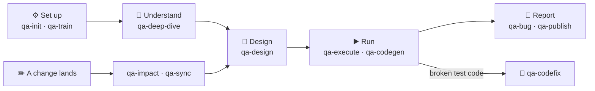

# qa-skills

**Agentic QA for Claude Code: turn requirements into test cases, run them, and catch what goes stale.**


14 `/qa-*` skills and one zero-dependency Node CLI. Everything they learn lives in your repo's `.qa/` folder.

- 📄 **Feed it requirements.** It settles them into Features with clear Rules.
- 🧪 **Get test cases.** It designs them, runs them against your app and records the results.
- 🔁 **Stay in sync.** When a change lands, it flags the cases that are now stale or conflicting.
- 🐞 **Close the loop.** It drafts bugs for failures and repairs broken test code.

**0.3.0, Claude Code only.** The [support matrix](https://github.com/Kinasr/qa-skills/blob/v0.3.6/docs/support.md)
says what is tested, what the CLI does with your data and what a Run keeps.

## 🔄 How it works



<!-- TODO: demo GIF of a first run goes here. -->

## 🚀 Quickstart

### You need

- **Claude Code 2.1.308 or newer.** `/qa-execute` refuses a host it cannot verify at that version
  ([details](https://github.com/Kinasr/qa-skills/blob/v0.3.6/docs/support.md#claude-code)).
- **Node 22 or newer**, Git, and a repository with at least one commit.
- **`playwright-cli` 0.1.22 or newer.** Playwright Test in your project does not replace it.

  ```sh
  npm install -g @playwright/cli@latest
  playwright-cli --version
  ```

- **A non-production target with dedicated test accounts.**

> [!WARNING]
> Executions create and change real application data, and you clean up what they leave behind.
> Anything the app shows (page text, screenshots, browser artifacts) can carry credentials, so
> confidentiality is not guaranteed. Read [data handling](https://github.com/Kinasr/qa-skills/blob/v0.3.6/docs/support.md#data-handling)
> before you point it at an application.

### Install

In Claude Code:

```text
/plugin marketplace add Kinasr/qa-skills
/plugin install qa-skills@qa-skills
```

Install the whole plugin; symlinking single skill folders breaks the CLI paths. Then open Claude Code
in the repository you want to test.

### First run

1. **Configure.** Run `/qa-skills:qa-init` and answer its questions. Accepting its Card writes
   `.qa/project.md` with your application targets and execution levels.
2. **Log in** (if your app needs it). Run `/qa-skills:qa-train access` and save the login state when
   it asks. It offers the `.gitignore` line that keeps those files out of Git.
3. **Learn a feature.** `/qa-skills:qa-deep-dive first-feature file:docs/requirements.md`
4. **Design its test cases.** `/qa-skills:qa-design first-feature`
5. **Run them.** `/qa-skills:qa-execute first-feature target:staging`, then read the Execution record
   before you commit it.

📖 The full walk-through, covering all three tracker paths, Access notes, Roles, YAML quoting and
interrupted-run recovery, is in [docs/first-run.md](docs/first-run.md). CLI commands are in
[docs/cli.md](docs/cli.md).

## 🧰 The skills

**Key terms:** a **Feature** is one area of your system's behaviour, stated as **Rules**. A
**Test Case** covers Rules. An **Execution** is one pass over one Test Case in the live app. A
**Run** is one invocation of a `/qa-*` command. A **Card** shows every change a command proposes,
and nothing is written until you accept it. Every term is defined in [GLOSSARY.md](GLOSSARY.md).

All commands use the installed `/qa-skills:` namespace.

| Stage | Skill | What it does |
| --- | --- | --- |
| ⚙️ Set up | `qa-init` | Sets up or maintains project configuration and Roles. |
| | `qa-train` | Teaches Conventions, Practices and Access notes. |
| 📄 Understand | `qa-deep-dive` | Settles References into a Feature with Rules. |
| | `qa-ask` | Answers a business question by quoting the governing Rules. |
| | `qa-show` | Lets you browse recorded Rules and Test Cases on a Knowledge page. |
| 🧪 Design | `qa-design` | Agrees Test Scenarios and fills them with Test Cases. |
| | `qa-impact` | Takes a small change to a Feature end to end: Rules, Stale cases, new cases. Big changes go to `qa-deep-dive`. |
| ▶️ Run | `qa-execute` | Executes Test Cases against a target, chosen by key, `tag:<name>` or `level:<name>`, and records the results. |
| | `qa-codegen` | Writes and binds one Automation per uncovered Test Case, in your project's trained style. |
| | `qa-codefix --run <dir>` | Repairs a Run's test-code fix items, with CLI verification and guarded edits. |
| 🐞 Report | `qa-bug` | Drafts one Bug per failed Test Case from a Run or a code-fix hand-off. |
| | `qa-publish` | Publishes after an accepted Card and commits the resulting Tracker keys and Mirrored values. |
| | `qa-sync` | Reconciles the knowledge layer with the tracker and the code, on a Card. |
| 🧭 Navigate | `qa-next` | Shows your Next steps without performing them. |

## 📚 Reference

<details>
<summary><strong>📁 What it keeps in your repo</strong></summary>

| Path | Holds |
| --- | --- |
| `.qa/project.md` | Project configuration |
| `.qa/features/` | Features and Test Scenarios |
| `.qa/train/` | Training |
| `.qa/observations/` | Observations |
| `.qa/executions/` | Execution records |

Commit reviewed knowledge. Keep login states and password files ignored: a Run never commits them,
and `/qa-train access` offers the matching `.gitignore` line.

Run directories in the OS temp directory hold pinned case text, briefs, reports and browser
artifacts. Ordinary artifacts survive ingest; ingest removes temporary auth, while your saved login
files stay yours to renew or delete.

The [storage and lifecycle table](https://github.com/Kinasr/qa-skills/blob/v0.3.6/docs/support.md#storage-and-lifecycle)
covers retention, retry and reset deletion, crash leftovers, model costs, concurrency and incomplete Runs.

</details>

<details>
<summary><strong>🔒 Data and safety</strong></summary>

- Use a reachable **non-production target with dedicated test accounts**. Executions create and
  change application data, and you clean up what they leave behind.
- Origin checks are not network isolation.
- Configured credential sources are kept out of model context. Recognised credential patterns are
  scrubbed from documented surfaces only.
- Anything an application exposes, such as page text, screenshots and raw browser artifacts, can
  carry credentials or other data. Confidentiality is not guaranteed.
- macOS and Linux are expected to work (live release evidence is pending). CI runs the CLI test
  suite on Linux. Windows is unsupported.

Exact configurations, stack coverage and the full data-handling rules are in the
[support matrix](https://github.com/Kinasr/qa-skills/blob/v0.3.6/docs/support.md#data-handling).

</details>

## 🤝 Get involved

- **Bugs and questions:** open an [issue](https://github.com/Kinasr/qa-skills/issues) with a
  sanitised reproduction. Never attach credentials, login states or client artifacts.
- **Security reports:** follow [SECURITY.md](SECURITY.md).
- **Pull requests:** invitation-only; see [CONTRIBUTING.md](CONTRIBUTING.md).

## 📜 License

MIT, see [LICENSE](LICENSE). The framework's licence does not cover your requirements, your `.qa/`
knowledge or material you import. Framework-owned templates written into your repository may be used
there without attribution. Claude Code is named descriptively; no endorsement is implied.
